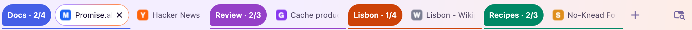
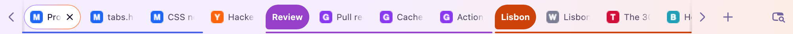
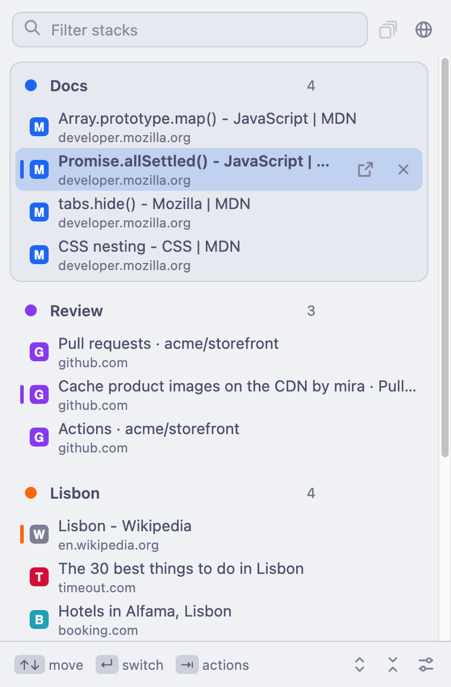
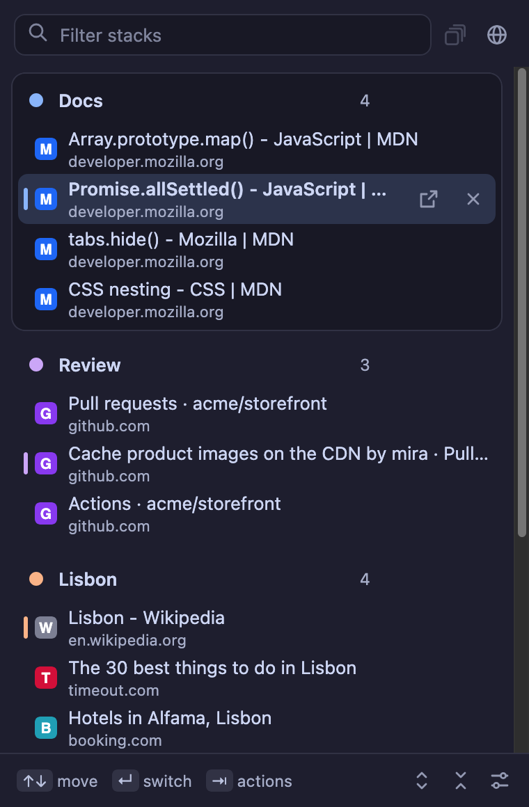

# Tab Stacks

Vivaldi-style tab stacks for Firefox. Group related tabs into a stack and the whole stack takes up a single slot in the tab bar.

<picture>
  <source media="(prefers-color-scheme: dark)" srcset="screenshots/tabs-stacked-dark.png">
  
</picture>

Firefox's own tab groups put a label in front of the tabs, but every tab stays on the tab bar. The same fifteen tabs in four groups look like this without Tab Stacks:

<picture>
  <source media="(prefers-color-scheme: dark)" srcset="screenshots/tabs-native-dark.png">
  
</picture>

Tab Stacks turns each group into a stack. Only one tab of the stack is on the tab bar, and the label tells you which one: `Docs · 2/4` is the second of four.

## What you can do

- **Make a stack** the way you make a Firefox tab group: drag a tab onto another tab, or right-click a tab and choose *Add Tab to Group*. You can also select a few tabs and press <kbd>⌃⇧S</kbd>.
- **Flip through a stack** with <kbd>⌃⇧.</kbd> and <kbd>⌃⇧,</kbd>.
- **Open a stack** by clicking its label. All its tabs show up in place, and they fold back when you click the label again or move to a tab outside the stack.
- **Close tabs without losing your place.** When you close the tab on top, the next tab in the same stack takes its place. A stack that's down to one tab turns back into a normal tab.
- **Keep links together.** A link opened from a stacked tab joins the same stack.
- **Stack by site** from the toolbar button or a tab's right-click menu. Every site with two or more loose tabs gets a stack named after it.

## The switcher

Click the toolbar button or press <kbd>⌃⇧Space</kbd> to see every stack and its tabs. The stack you're in comes first.

<p align="center">
  
  
</p>

- Type to filter, <kbd>↑</kbd> <kbd>↓</kbd> (or <kbd>⌃J</kbd> <kbd>⌃K</kbd>) to move, <kbd>↵</kbd> to switch.
- Press <kbd>⇥</kbd> for single-key actions: <kbd>x</kbd> closes a tab, <kbd>e</kbd> takes it out of its stack, <kbd>r</kbd> renames the stack.
- Drag tabs to reorder them or move them to another stack.
- Rename, open, dissolve or close a whole stack from its header.

It follows your system's light or dark mode, with the [Catppuccin](https://catppuccin.com) Latte and Mocha palettes.

## Shortcuts

| Action | macOS | Windows and Linux |
| --- | --- | --- |
| Open the switcher | <kbd>⌃⇧Space</kbd> | <kbd>Alt+Shift+Space</kbd> |
| Next tab in the stack | <kbd>⌃⇧.</kbd> | <kbd>Alt+Shift+.</kbd> |
| Previous tab in the stack | <kbd>⌃⇧,</kbd> | <kbd>Alt+Shift+,</kbd> |
| Stack the selected tabs | <kbd>⌃⇧S</kbd> | <kbd>Alt+Shift+S</kbd> |
| Open or fold the current stack | <kbd>⌃⇧E</kbd> | <kbd>Alt+Shift+E</kbd> |
| Take the tab out of its stack | <kbd>⌃⇧X</kbd> | <kbd>Alt+Shift+X</kbd> |

Change them in `about:addons` → gear menu → *Manage Extension Shortcuts*.

## Settings

Open `about:addons` → Tab Stacks → *Preferences* to choose:

- whether labels show the `2/4` counter
- whether closing the top tab moves to the next tab in the stack
- whether a stack with one tab left turns back into a normal tab
- whether an open stack folds when you leave it
- whether clicking a label opens the stack or uses Firefox's own collapse
- whether links from a stacked tab join the stack or open beside it

## Install

Tab Stacks needs Firefox 142 or newer. It isn't on addons.mozilla.org, so you load it from this repository.

```bash
git clone https://github.com/bassepeder/tabstacks.git
```

**To try it:** open `about:debugging#/runtime/this-firefox`, click *Load Temporary Add-on…* and pick `manifest.json`. Firefox removes it again when it restarts.

**To keep it:** release Firefox only installs add-ons that Mozilla has signed. Signing as *unlisted* is free and private, and takes about a minute. Get an API key at [addons.mozilla.org/developers/addon/api/key](https://addons.mozilla.org/developers/addon/api/key/), then run this in the repository:

```bash
npx web-ext sign --channel=unlisted --api-key=$AMO_JWT_ISSUER --api-secret=$AMO_JWT_SECRET
```

Drag the `.xpi` from `web-ext-artifacts/` into Firefox. On Firefox Developer Edition or Nightly you can skip signing: set `xpinstall.signatures.required` to `false` in `about:config` and install the zip from `npx web-ext build`.

The first time Tab Stacks hides a tab, Firefox asks whether to keep tabs hidden. Choose *Keep Tabs Hidden*.

## How it works

A stack is an ordinary Firefox tab group. The extension hides every tab in the group except one with Firefox's `tabs.hide()`, and keeps the counter in the group's label up to date. Firefox still decides which tab belongs to which group, so its own drag and drop and menus keep working, and turning the extension off leaves you with normal tab groups.

## Limits

- Extensions can't draw on Firefox's tab bar, so the label and counter are the only sign that a tab is part of a stack. There are no hover previews like in Vivaldi.
- Hidden tabs still appear in Firefox's *List All Tabs* menu.
- When you close the tab on top of a stack, Firefox picks the next tab before the extension hears about it. The extension switches to the next tab in the stack straight away, but Firefox's pick can flash for a moment.
- The counter is part of the group's name. If you remove the extension, labels keep their last `· 2/4` until you rename them.

## Development

The tests start a headless Firefox from `/Applications` with a throwaway profile, install the extension and drive real tabs over Marionette. They only need Python 3.

```bash
python3 test/test_tabstacks.py
```

Add `-k name` to run only the tests whose name contains `name`. To regenerate the screenshots in this README:

```bash
python3 test/screenshots.py
```
